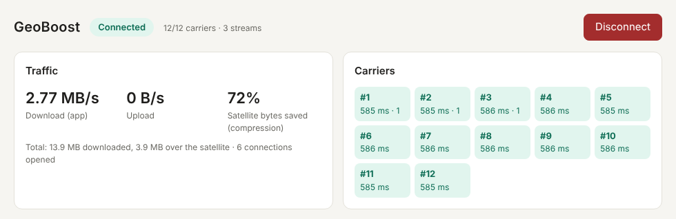
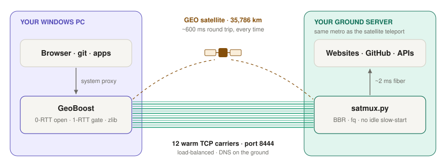
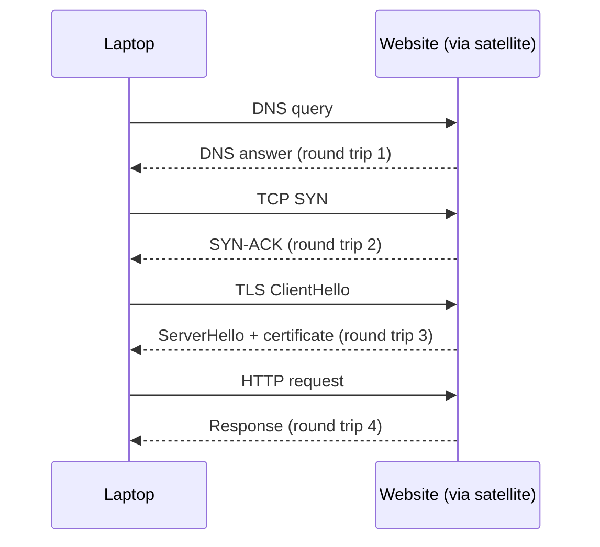
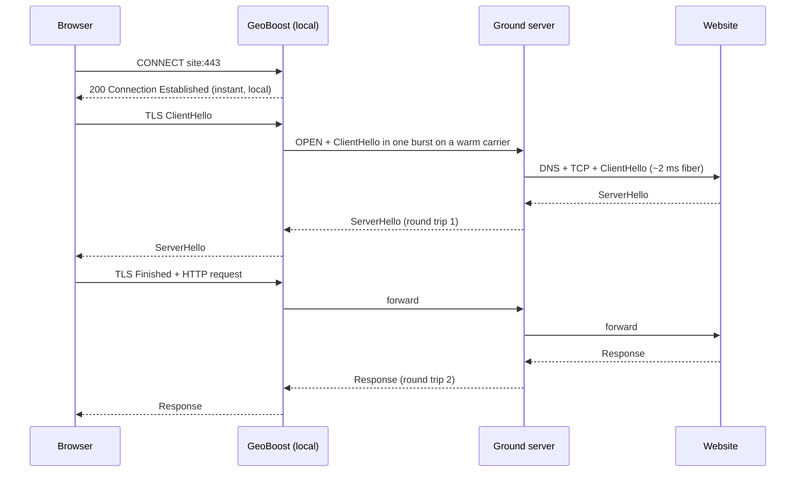
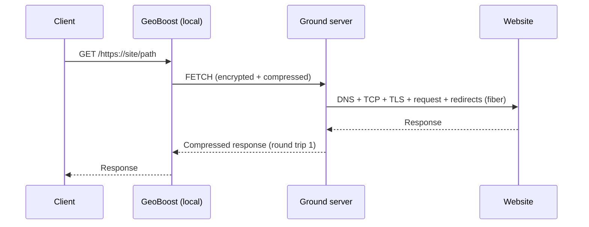
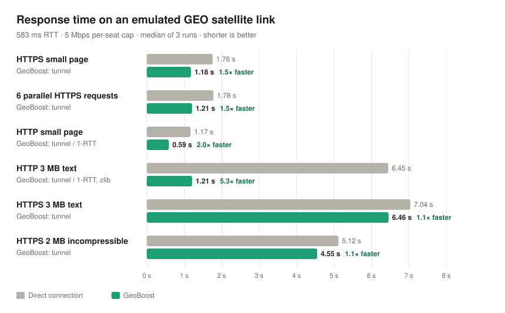
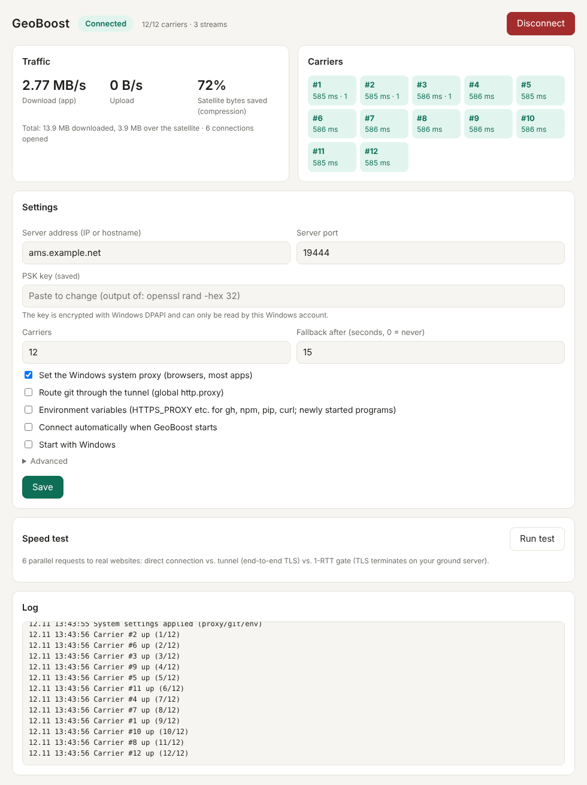

<div align="center">


# GeoBoost

**Make high-latency satellite internet feel usable again.**

GeoBoost is a small Windows app that cuts the number of round trips your traffic makes over a GEO satellite link, such as in-flight Wi-Fi, VSAT or maritime internet. The result is faster page loads, `git` that stops timing out, and fewer dropped connections.<br>
It is a single `.exe`: no Python, no installer and no admin rights needed.

[](#quick-start)
[](#building-from-source)
[](LICENSE)
[](https://github.com/Th0rgal/satmux)

[**Download**](https://github.com/muskec06/geoboost/releases/latest) · [Quick start](#quick-start) · [How it works](#how-it-works) · [Benchmarks](#benchmarks) · [FAQ](#troubleshooting--faq)

<picture>
  <source media="(prefers-color-scheme: dark)" srcset="docs/images/panel-dark.png">
  
</picture>

<sub>The GeoBoost panel, captured on an emulated GEO link with a 585 ms round-trip time.</sub>

</div>

---

## Contents

- [Why GeoBoost?](#why-geoboost)
- [Features](#features)
- [How it works](#how-it-works)
- [Benchmarks](#benchmarks)
- [Quick start](#quick-start)
- [Using GeoBoost](#using-geoboost)
- [What GeoBoost changes on your PC](#what-geoboost-changes-on-your-pc)
- [Security model](#security-model)
- [Configuration reference](#configuration-reference)
- [Troubleshooting & FAQ](#troubleshooting--faq)
- [Building from source](#building-from-source)
- [Roadmap](#roadmap)
- [Credits & license](#credits--license)

---

## Why GeoBoost?

Geostationary satellites orbit at **35,786 km**. A single request/response pair has to travel up and down twice, so the round-trip time (RTT) is **about 600 ms**, and no amount of bandwidth changes that. The real cost comes from how many round trips ordinary internet traffic needs:

| Step to open a new HTTPS site | Round trips | On a GEO link |
|---|:---:|:---:|
| DNS lookup | 1 | ~0.6 s |
| TCP handshake | 1 | ~0.6 s |
| TLS 1.3 handshake | 1 | ~0.6 s |
| HTTP request → first byte | 1 | ~0.6 s |
| **Total, before any content arrives** | **4** | **≈ 2.4 s** |

Satellite links also have two other common problems:

- **Overloaded cabin gateways.** Onboard performance-enhancing proxies intercept DNS and port 443. Under load their connection tables overflow, which shows up as `connection reset` errors, TLS timeouts and failed `git` and package-manager operations.
- **Loss-sensitive congestion control.** Standard TCP (CUBIC) treats cabin Wi-Fi radio loss as congestion and halves its sending rate, then takes many 600 ms round trips to recover.

GeoBoost avoids all three. Your traffic rides **pre-warmed connections** to a small server you control near the satellite ground station. The handshakes happen on that server's fiber in milliseconds, and the satellite only carries the data.

## Features

- **Fewer satellite round trips.** New HTTPS connections take **2 round trips instead of 3–4**. Requests through the 1-RTT gate take **one**.
- **12 warm carriers.** Persistent TCP connections to your ground server are kept open and balanced by recent load, so the TCP slow start cost is paid once rather than on every connection.
- **Avoids the cabin gateway.** Carriers use port 8444, which onboard proxies leave alone. DNS is resolved on the ground.
- **On-the-fly compression** of uncompressed traffic. Text, HTML and JSON typically shrink by 70–90% on the satellite hop.
- **One-click Windows integration.** GeoBoost sets the system proxy (Edge, Chrome and most apps), `git`, and optionally `HTTPS_PROXY` for CLI tools.
- **Safety nets throughout.** Original settings are saved before anything changes and restored on disconnect, quit, Windows logoff, or the next start after a crash. If the tunnel dies, GeoBoost switches back to a direct connection automatically.
- **Live control panel** showing per-carrier latency, throughput, bytes saved, a built-in speed test and the log.
- **Tray app.** The tray icon's color shows the connection state at a glance.
- **Small and self-contained.** ~3 MB `.exe` written in Rust with tokio. The PSK is encrypted with Windows DPAPI.
- **Works with the existing server.** GeoBoost speaks the [satmux](https://github.com/Th0rgal/satmux) v3 wire protocol byte for byte, and the ground server is the unmodified `satmux.py`.

## How it works

<p align="center">
<picture>
  <source media="(prefers-color-scheme: dark)" srcset="docs/images/architecture-dark.svg">
  
</picture>
</p>

GeoBoost has two ways of carrying traffic, and you choose per request.

| | **Tunnel** (default) | **1-RTT gate** |
|---|---|---|
| Used by | Browsers, `git`, apps via the system proxy / SOCKS5 | Anything that requests `http://127.0.0.1:18081/https://site/path` |
| Satellite round trips for a new HTTPS site | **2** | **1** |
| Compression on the satellite hop | Only for non-TLS traffic | Always (zlib) |
| TLS | **End-to-end.** The ground server cannot read your traffic | **Terminates on your ground server**, which fetches the page for you |
| Best for | Everyday browsing, logins, `git` | Bulk downloads, APIs and docs from your own trusted server |

<details>
<summary><b>Where the round trips go: direct vs. GeoBoost tunnel vs. 1-RTT gate</b></summary>

**Direct connection: 4 satellite round trips**



**GeoBoost tunnel: 2 satellite round trips, TLS stays end-to-end**



**1-RTT gate: 1 satellite round trip**



</details>

## Benchmarks

<picture>
  <source media="(prefers-color-scheme: dark)" srcset="docs/images/benchmark-dark.svg">
  
</picture>

| Scenario (583 ms RTT, 5 Mbps cap) | Direct | GeoBoost tunnel | 1-RTT gate | Speed-up |
|---|---:|---:|---:|:---:|
| HTTPS small page | 1.76 s | **1.18 s** | – | **1.5×** |
| 6 parallel HTTPS requests | 1.78 s | **1.21 s** | – | **1.5×** |
| HTTP small page | 1.17 s | **0.59 s** | **0.59 s** | **2.0×** |
| HTTP 3 MB text (compressible) | 6.45 s | **1.21 s** | **1.21 s** | **5.3×** |
| HTTPS 3 MB text | 7.04 s | **6.46 s** | – | 1.1× |
| HTTPS 2 MB incompressible | 5.12 s | **4.55 s** | – | 1.1× |

**How these numbers were measured**

The setup was a userspace satellite emulator ([`tools/satrelay.py`](tools/satrelay.py)) with:

- 290 ms one-way delay, giving an RTT of 583 ms as reported by GeoBoost's own carrier pings
- TCP handshake cost modeled (no data can flow before the SYN/SYN-ACK round trip)
- A shared 5 Mbps per-seat bandwidth cap

"Direct" requests went through the emulator straight to the origin. GeoBoost requests went laptop → emulator → `satmux.py` → origin. Each number is the median of 3 runs.

**Reading the results**

- **Small requests** gain the most because they are round-trip bound: HTTPS drops from 3 to 2 round trips, and plain HTTP or the gate drops from 2 to 1.
- **Large HTTPS downloads** are bandwidth bound. Encrypted data cannot be compressed, so only the handshake time is saved. To speed these up, fetch them through the 1-RTT gate.
- **The 5.3× figure** comes from a test file that compresses by 91%. Real HTML and JSON usually compress by 70–85%, so expect roughly 3–4× there.

> [!NOTE]
> These results understate the real-world benefit. The emulator does not model the extra DNS round trip on the direct path, cabin-gateway connection resets (often the biggest real-world problem, where GeoBoost turns failures into successes), or TCP slow start and Wi-Fi loss, where warm carriers and BBR help. Real-flight reports are very welcome. Please open an issue with your speed-test results.

**Reproduce it yourself** (Linux, root needed for port 443):

```bash
./tools/latency-bench.sh                 # 583 ms RTT, 5 Mbps
OW=300 RATE=10 ./tools/latency-bench.sh  # custom one-way delay (ms) and cap (Mbps)
```

## Quick start

### 1. Set up your ground server (once, ~5 minutes)

Rent the smallest Linux VM (Ubuntu or Debian) **in the same metro area as your satellite provider's ground station (teleport)**. To find out where your traffic lands, run `curl ipinfo.io` while you are on the satellite link and look at the country and city. For example, Inmarsat GX via SITA usually exits in the Netherlands, so Amsterdam or Frankfurt works well for European flights. A server far from the teleport loses most of the benefit.

Then copy the `server` folder from the release and run the installer:

```bash
scp -r server root@SERVER_IP:/root/geoboost-server
ssh root@SERVER_IP 'cd /root/geoboost-server && bash install-server.sh'
```

The installer:

- runs `satmux.py` as a hardened systemd service (unprivileged user, auto-restart)
- generates a random PSK
- enables BBR, `fq` and `tcp_slow_start_after_idle=0`

When it finishes, it prints everything the app needs:

```
================================================================
 GeoBoost server is running.

 Enter these in the GeoBoost app on Windows:
   Server address : 203.0.113.10
   Server port    : 8444
   PSK key        : 3f9c…e1a7
================================================================
```

> [!IMPORTANT]
> Allow **TCP 8444** in your cloud provider's firewall. The installer opens it in `ufw` if `ufw` is active, but provider-level firewalls must be opened separately.

### 2. Run GeoBoost on Windows

1. Download `GeoBoost-windows-x64.zip` from [Releases](https://github.com/muskec06/geoboost/releases/latest), unzip it, and run `geoboost.exe`. The panel opens in your browser on first start.
   - The build is not code-signed yet, so SmartScreen may warn you. Choose **More info → Run anyway**.
2. Enter the **server address**, **port** and **PSK**, then click **Save**.
3. Click **Connect**. When the tray icon turns  green, you're done.

### 3. On the plane

Sign in to the airline's Wi-Fi portal first, then connect GeoBoost. Pause UDP-based VPNs such as WireGuard or Tailscale while you fly.

## Using GeoBoost

| Tray icon | State | Meaning |
|:---:|---|---|
|  | **Off** | Not connected. No system settings are changed. |
|  | **Connecting** | Waiting for the first carrier. |
|  | **Connected** | Traffic is accelerated. The tooltip shows how many carriers are up, e.g. `12/12 carriers`. |
|  | **Fallback** | No carrier for 15 s. The system proxy is paused so your internet keeps working directly, and it resumes automatically when the carriers come back. |

**Left-click** the tray icon to open the panel. **Right-click** for Connect/Disconnect and Quit.

<details>
<summary><b>Full control panel</b> (settings, speed test, log)</summary>
<br>
<picture>
  <source media="(prefers-color-scheme: dark)" srcset="docs/images/panel-full-dark.png">
  
</picture>
</details>

The panel's **Speed test** fires six parallel requests at real websites (GitHub, Hacker News, MDN, PyPI and others) over three paths: direct, tunnel and 1-RTT gate. It then shows the time per site and the speed-up. Run it on your first flight to see what GeoBoost does on your link.

## What GeoBoost changes on your PC

Each change can be switched on or off in the panel:

| Setting | Default | What it does |
|---|:---:|---|
| Windows system proxy | ✅ | `127.0.0.1:18080` for Edge, Chrome and WinINet apps. LAN, localhost, private IP ranges and your ground server are always bypassed. |
| `git` | ✅ | `git config --global http.proxy socks5h://127.0.0.1:11080` |
| Environment variables | ⬜ | `HTTP_PROXY`, `HTTPS_PROXY`, `ALL_PROXY`, `NO_PROXY` for `gh`, `npm`, `pip`, `curl` and other CLI tools. Only programs started after this is set pick it up. |

**Safety nets**

1. Before touching anything, GeoBoost writes your current settings to `%APPDATA%\GeoBoost\restore.json`.
2. It restores them on **Disconnect**, **Quit** and **Windows logoff or shutdown**.
3. If the app crashes, the next start restores your settings first.
4. If the tunnel is down for 15 s, the system proxy is paused automatically (Fallback).
5. Emergency switch, which restores everything without starting the app:
   ```
   geoboost.exe --restore
   ```

## Security model

GeoBoost is a performance tool, **not a VPN**. Please read this before using it with sensitive accounts.

- **Tunnel mode:** HTTPS stays encrypted end-to-end between your browser and the website, so your ground server cannot read it. GeoBoost itself adds no encryption in this mode, which means destination hostnames and any plain-HTTP traffic are visible on the satellite hop.
- **1-RTT gate:** TLS terminates on **your** ground server, which sees the full request and response, including cookies and tokens. Only use it with a server you control. Gate requests are encrypted on the satellite hop with a BLAKE2b keystream but have **no integrity tag (MAC)**, a limitation of the satmux v3 protocol.
- **Authentication:** carriers authenticate with HMAC-SHA256 over a 256-bit pre-shared key. The PSK is stored encrypted with **Windows DPAPI** and can only be decrypted by your Windows account.
- **Local panel:** it listens on `127.0.0.1` only, requires a random per-run token, and validates the `Host` header to block DNS-rebinding attacks from web pages.

Authenticated, encrypted carriers (TLS on the carriers) are first on the [roadmap](#roadmap).

## Configuration reference

The configuration is stored in `%APPDATA%\GeoBoost\config.json` and is normally edited through the panel.

| Key | Default | Description |
|---|---|---|
| `server_host` / `server_port` | – / `8444` | Your ground server |
| `carriers` | `12` | Number of warm carriers (1–64) |
| `socks_port` | `11080` | Local SOCKS5 proxy |
| `http_port` | `18080` | Local HTTP/CONNECT proxy (used as the system proxy) |
| `gate_port` | `18081` | Local 1-RTT gate |
| `panel_port` | `18090` | Control panel |
| `set_system_proxy` / `set_git` / `set_env` | `true` / `true` / `false` | Windows integration toggles |
| `bypass` | `""` | Extra proxy bypass entries, `;`-separated |
| `fallback_secs` | `15` | Pause the system proxy after this many seconds with no carrier (`0` = never) |
| `auto_connect` / `autostart` | `false` | Connect on launch / start with Windows |

If a local port is already in use, GeoBoost picks the next free one automatically and saves it.

**Command-line flags:** `--connect` (connect on launch) · `--autostart` (start without opening the panel) · `--restore` (restore system settings and exit)

**Files** in `%APPDATA%\GeoBoost\`: `config.json` · `geoboost.log` · `restore.json` (only while connected)

## Troubleshooting & FAQ

<details>
<summary><b>The panel shows someone else's page (e.g. "Whitelabel Error Page")</b></summary>

Another program, often a local Java, Node or dev server, owns the port. GeoBoost detects busy ports and moves to the next free one. Always open the panel from the **tray icon**, which knows the real address.
</details>

<details>
<summary><b>My internet stopped working after a crash</b></summary>

Start GeoBoost again: it restores your settings on launch. Alternatively, run `geoboost.exe --restore`.
</details>

<details>
<summary><b>All carriers stay on "waiting"</b></summary>

Check the panel log. The usual causes are:

- **TCP 8444 is blocked** in your provider's firewall.
- **Wrong PSK.** The log says "server could not be verified".
- **You are not signed in** to the airline's Wi-Fi portal yet.
</details>

<details>
<summary><b>Will it make video streaming faster?</b></summary>

Barely. Video is already compressed and is limited by your seat's bandwidth cap. GeoBoost helps most with web pages, APIs, `git` and package managers, where most of the time is spent on round trips.
</details>

<details>
<summary><b>Does it help on Starlink or other LEO satellites?</b></summary>

Very little. LEO round trips are 30–50 ms, so there is not much latency to remove. GeoBoost is built for GEO links (~600 ms).
</details>

<details>
<summary><b>Do I need admin rights?</b></summary>

No. Everything GeoBoost changes is per-user: `HKCU` proxy settings, your global git config and your user environment.
</details>

## Building from source

On Windows with [Rust](https://rustup.rs) installed:

```powershell
cargo build --release      # target\release\geoboost.exe
```

Cross-compiling from Linux:

```bash
rustup target add x86_64-pc-windows-gnu
sudo apt install mingw-w64
cargo build --release --target x86_64-pc-windows-gnu
```

On Linux, the same binary runs headless (no tray, no system integration), which is used for protocol testing:

```bash
GEOBOOST_HOME=/tmp/gb cargo run --release -- --connect
```

GitHub Actions builds and tests every push, and attaches `GeoBoost-windows-x64.zip` to every `v*` tag release ([workflow](.github/workflows/build.yml)).

<details>
<summary><b>Project layout</b></summary>

```
src/
  mux.rs        satmux v3 wire protocol: carriers, handshake, framing, BLAKE2b keystream, load balancing
  proxy.rs      local SOCKS5, HTTP/CONNECT proxy and 1-RTT gate
  app.rs        connect/disconnect, watchdog & fallback, stats
  panel.rs      local control panel (HTTP API, token + Host checks)
  panel.html    panel UI (single file, light/dark)
  bench.rs      built-in speed test
  win.rs        Windows: tray, WinINet proxy, git, env vars, DPAPI, autostart, session-end handling
  nowin.rs      non-Windows stubs for headless testing
server/
  satmux.py           upstream ground server (unmodified)
  install-server.sh   one-command, hardened server setup
tools/
  satrelay.py         GEO satellite link emulator (delay, handshake cost, bandwidth cap)
  latency-bench.sh    reproduces the benchmark table
  origins.py          local HTTP/HTTPS test origins
  make_chart.py       renders the benchmark chart
  make_diagram.py     renders the architecture diagram
```
</details>

**Test coverage.** The protocol core is verified against the real `satmux.py` server:

- 20 MB downloads and uploads with byte-for-byte hash checks
- TLS, SOCKS5, CONNECT and the 1-RTT gate
- 40 parallel streams
- Server crash and reconnect, wrong PSK
- The BLAKE2b keystream matches Python's output exactly

The Windows build is exercised under Wine: DPAPI, proxy registry changes, fallback, crash recovery and port fallback. Testing on real Windows hardware during real flights is ongoing.

## Roadmap

- [ ] TLS-wrapped carriers with certificate pinning (hides hostnames, adds integrity), with server support
- [ ] Streaming compression per stream and zstd for better ratios
- [ ] Selectable congestion control on the server (BBR / BBRv3 / Hybla) to compare per link
- [ ] Opt-in image re-encoding on the 1-RTT gate
- [ ] Signed Windows releases and a `winget` package
- [ ] macOS and Linux tray clients

## Credits & license

GeoBoost is released under the [MIT License](LICENSE).

The wire protocol and the ground server (`server/satmux.py`) come from **[satmux](https://github.com/Th0rgal/satmux)** by Thomas Marchand (MIT). GeoBoost is an independent Windows client that is protocol-compatible with it. The upstream license is included at [`server/LICENSE-satmux-upstream`](server/LICENSE-satmux-upstream).
